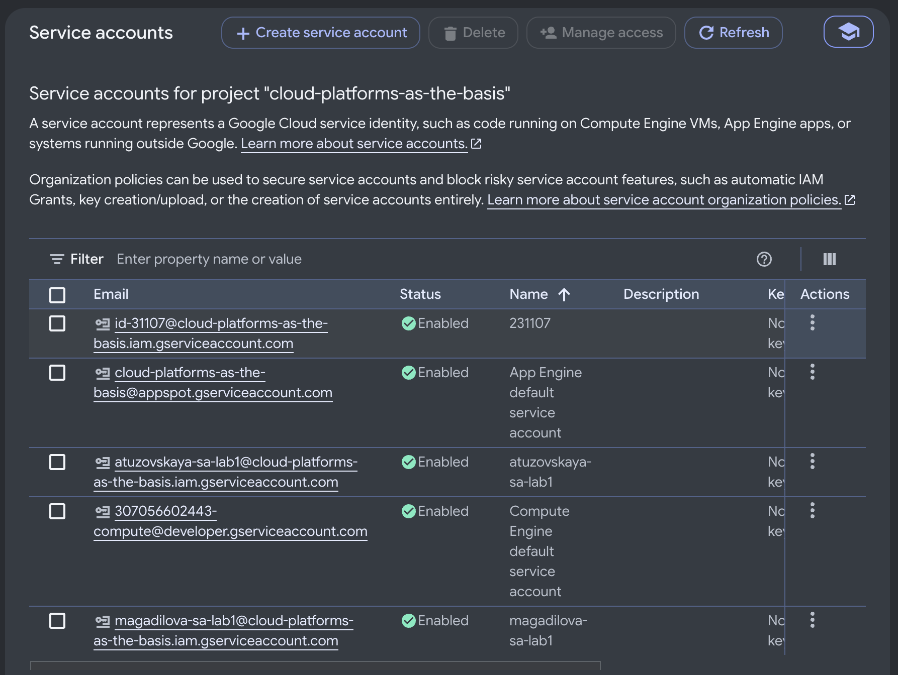
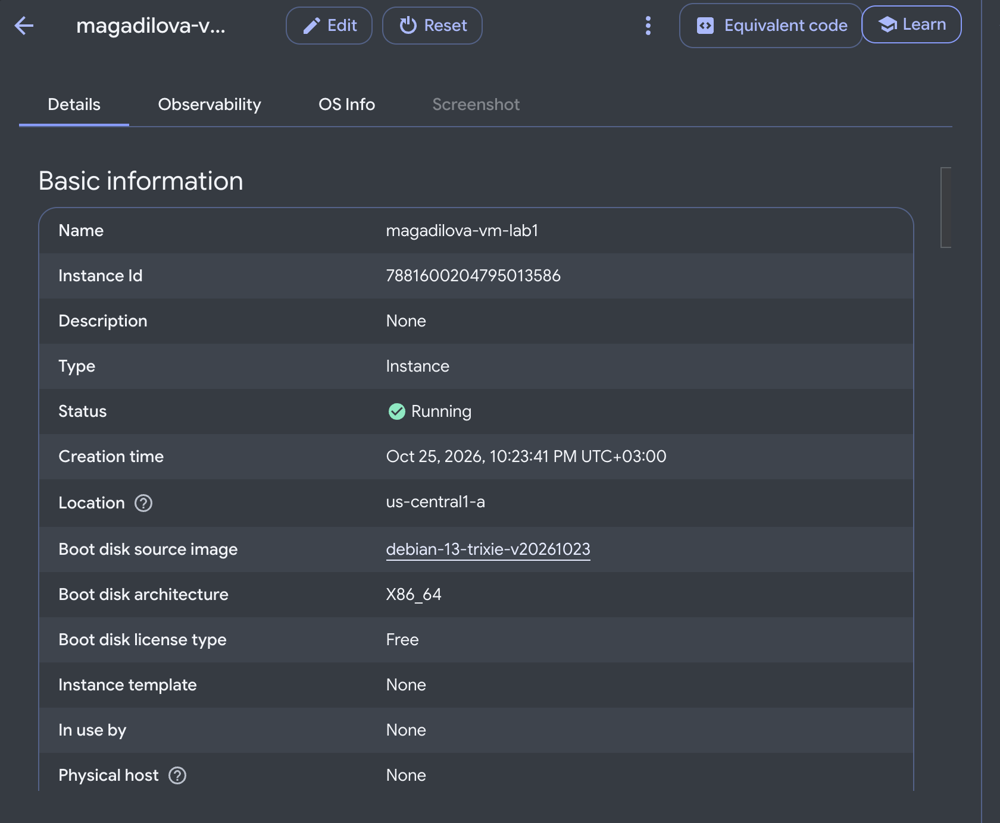
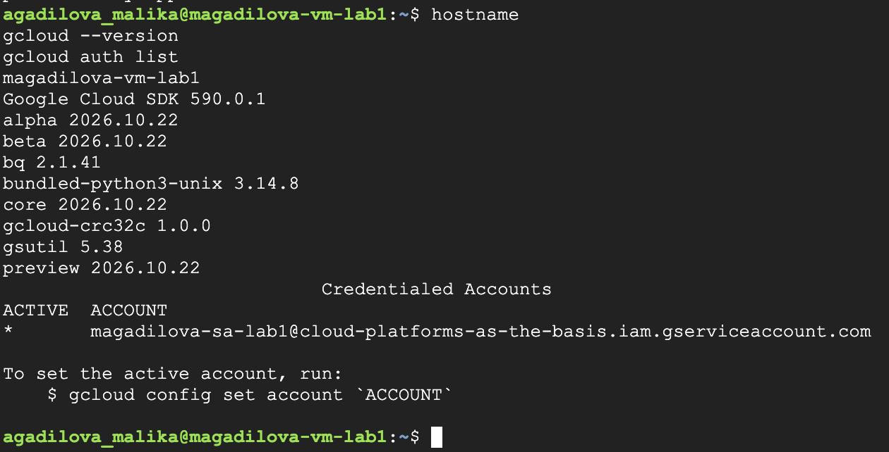
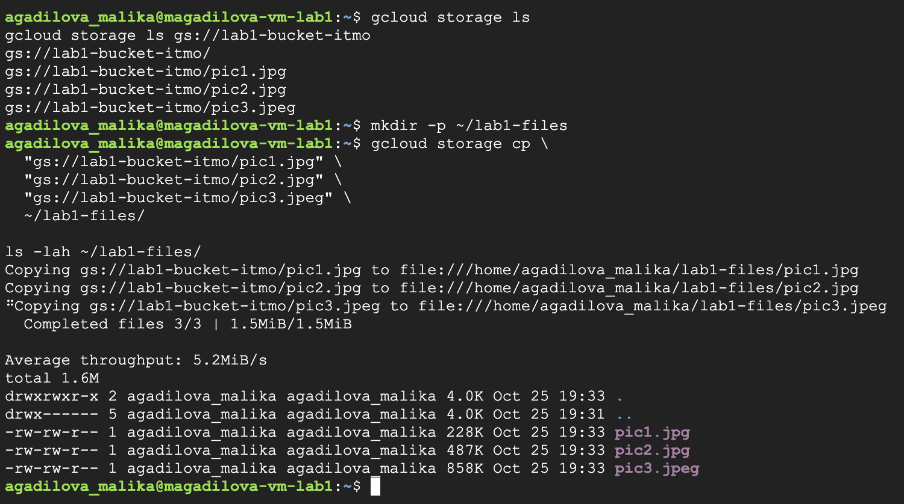
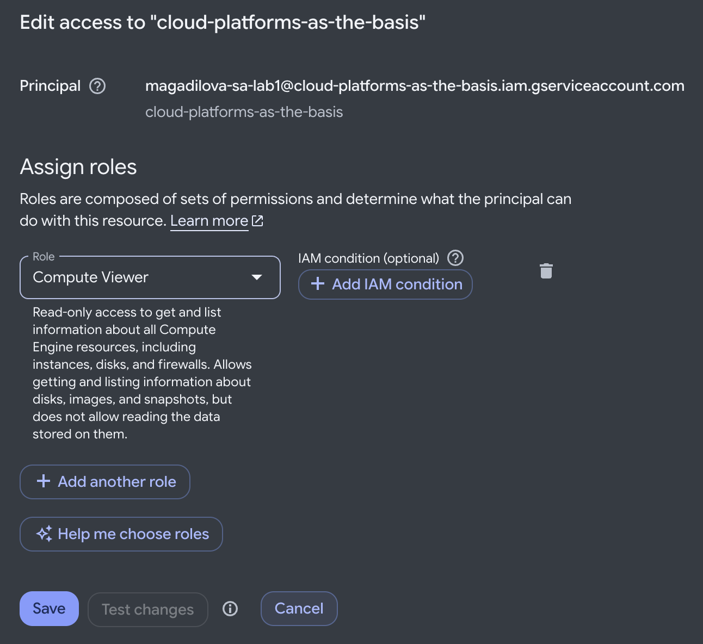
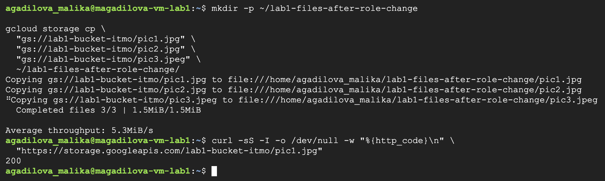
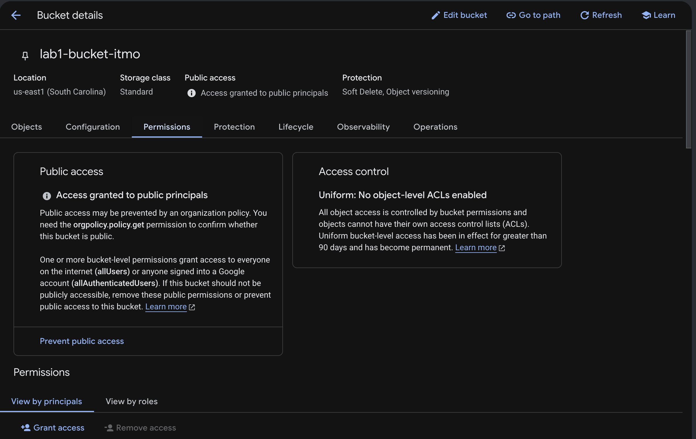

# Лабораторная работа №1. Обзор Google Cloud и исследование основных сервисов

University: [ITMO University](https://itmo.ru/ru/)  
Faculty: [FICT](https://fict.itmo.ru)  
Course: [Cloud platforms as the basis of technology entrepreneurship](https://github.com/ex-itmo-ict-faculty/cloud-platforms-as-the-basis-of-technology-entrepreneurship)  
Year: 2026/2027  
Group: U4225  
Author: Agadilova Malika  
Lab: Lab1  
Date of create: 25.10.2026  
Date of finished: —

Дата окончания заполняется после защиты лабораторной работы перед преподавателем.

## Цель работы

Ознакомиться с основными возможностями Google Cloud: управлением доступом через IAM, использованием сервисных учётных записей, созданием виртуальной машины Compute Engine и загрузкой объектов из Cloud Storage. Проверить, как изменение роли сервисной учётной записи влияет на доступ к данным.

## Задание

1. Получить доступ к учебному проекту Google Cloud.
2. Создать service account с ролью `Storage Admin`.
3. Создать виртуальную машину типа `e2-micro` в режиме Spot.
4. С помощью `gcloud` найти бакет `lab1-bucket-itmo`, скопировать три файла на VM и проверить их наличие командой `ls -lah`.
5. Заменить роль `Storage Admin` на `Compute Viewer`, повторить копирование и объяснить результат.
6. Удалить созданные ресурсы и подготовить отчёт со скриншотами.

Источник: [задание лабораторной работы №1](https://github.com/ex-itmo-ict-faculty/cloud-platforms-as-the-basis-of-technology-entrepreneurship/blob/main/docs/education/labs2023-2024/lab1/lab1.md).

## Используемые ресурсы и инструменты

| Параметр | Значение |
| --- | --- |
| Project ID | `cloud-platforms-as-the-basis` |
| Service account | `magadilova-sa-lab1` |
| Email service account | `magadilova-sa-lab1@cloud-platforms-as-the-basis.iam.gserviceaccount.com` |
| Виртуальная машина | `magadilova-vm-lab1` |
| Тип VM | `e2-micro` |
| Модель предоставления VM | Spot |
| Зона VM | `us-central1-a` |
| Операционная система | Debian 13, образ `debian-13-trixie-v20261023` |
| Архитектура | `x86_64` |
| Google Cloud SDK | `590.0.1` |
| gsutil | `5.38` |
| Учебный бакет | `gs://lab1-bucket-itmo` |
| Расположение бакета | `us-east1` (South Carolina) |

## Ход работы

### 1. Подготовка сервисной учётной записи

Работа выполнялась в учебном проекте `cloud-platforms-as-the-basis`. В разделе **IAM & Admin → Service Accounts** была создана сервисная учётная запись `magadilova-sa-lab1`. Имя составлено из первой буквы имени и фамилии с суффиксом `-sa-lab1`.

На первом этапе учётной записи была назначена роль `Storage Admin` (`roles/storage.admin`) для работы с Cloud Storage. Эта роль предоставляет права управления бакетами и объектами в области её назначения.



*Рисунок 1 — созданная сервисная учётная запись со статусом Enabled.*

### 2. Создание виртуальной машины

В Compute Engine была создана VM `magadilova-vm-lab1` типа `e2-micro` с моделью предоставления Spot. Для машины выбрана зона `us-central1-a` и операционная система Debian 13. К VM подключена учётная запись `magadilova-sa-lab1`.



*Рисунок 2 — имя, состояние Running, зона и образ операционной системы виртуальной машины.*

После подключения по SSH были проверены имя хоста, версия Google Cloud SDK и активная учётная запись:

```bash
hostname
gcloud --version
gcloud auth list
```

Имя хоста — `magadilova-vm-lab1`, версия Google Cloud SDK — `590.0.1`. В выводе `gcloud auth list` активной указана созданная сервисная учётная запись:

```text
ACTIVE  ACCOUNT
*       magadilova-sa-lab1@cloud-platforms-as-the-basis.iam.gserviceaccount.com
```

Это подтверждает, что команды `gcloud` выполнялись от имени service account, а не личного Google-аккаунта.



*Рисунок 3 — проверка окружения внутри VM и активной сервисной учётной записи.*

### 3. Поиск бакета и загрузка файлов

Для просмотра доступных бакетов и содержимого учебного бакета выполнены команды:

```bash
gcloud storage ls
gcloud storage ls gs://lab1-bucket-itmo
```

В бакете обнаружены три объекта:

```text
gs://lab1-bucket-itmo/pic1.jpg
gs://lab1-bucket-itmo/pic2.jpg
gs://lab1-bucket-itmo/pic3.jpeg
```

На VM создан каталог `~/lab1-files`, после чего файлы загружены в него:

```bash
mkdir -p ~/lab1-files

gcloud storage cp \
  "gs://lab1-bucket-itmo/pic1.jpg" \
  "gs://lab1-bucket-itmo/pic2.jpg" \
  "gs://lab1-bucket-itmo/pic3.jpeg" \
  ~/lab1-files/

ls -lah ~/lab1-files/
```

Копирование завершилось сообщением `Completed files 3/3`. Команда `ls -lah` подтвердила наличие всех трёх изображений на локальном диске VM:

| Файл | Размер в выводе `ls -lah` |
| --- | --- |
| `pic1.jpg` | 228K |
| `pic2.jpg` | 487K |
| `pic3.jpeg` | 858K |



*Рисунок 4 — поиск бакета и успешная загрузка трёх изображений на виртуальную машину.*

### 4. Замена роли на Compute Viewer

В разделе **IAM & Admin → IAM** для `magadilova-sa-lab1` роль `Storage Admin` была заменена на `Compute Viewer` (`roles/compute.viewer`).

`Compute Viewer` позволяет просматривать сведения о ресурсах Compute Engine, но сама по себе не предоставляет разрешение `storage.objects.get`, необходимое для чтения объектов Cloud Storage.



*Рисунок 5 — настройка роли Compute Viewer для magadilova-sa-lab1.*

После изменения роли была повторно проверена активная учётная запись с помощью `gcloud auth list`. Активным остался тот же service account:

```text
ACTIVE  ACCOUNT
*       magadilova-sa-lab1@cloud-platforms-as-the-basis.iam.gserviceaccount.com
```

Для повторного копирования создан отдельный каталог, чтобы отличить новые загрузки от файлов, полученных на предыдущем этапе:

```bash
mkdir -p ~/lab1-files-after-role-change

gcloud storage cp \
  "gs://lab1-bucket-itmo/pic1.jpg" \
  "gs://lab1-bucket-itmo/pic2.jpg" \
  "gs://lab1-bucket-itmo/pic3.jpeg" \
  ~/lab1-files-after-role-change/
```

Несмотря на замену роли, все три файла снова были успешно загружены: получено сообщение `Completed files 3/3`. Ошибка доступа не возникла, поэтому была выполнена дополнительная проверка публичной доступности объекта.

### 5. Исследование причины сохранения доступа

Для проверки `pic1.jpg` выполнен HTTP-запрос без передачи учётных данных:

```bash
curl -sS -I -o /dev/null -w "%{http_code}\n" \
  "https://storage.googleapis.com/lab1-bucket-itmo/pic1.jpg"
```

Получен ответ:

```text
200
```

Параметр `-I` отправляет запрос HEAD и получает заголовки без загрузки содержимого файла; `-o /dev/null` скрывает полученные заголовки, а `-w` выводит HTTP-код. В команде не передаются токен авторизации или cookies. Обычный `curl` не использует автоматически учётные данные подключённого к VM service account.

Следовательно, HTTP `200` подтверждает доступность `pic1.jpg` для анонимного запроса. Для этого объекта права сервисной учётной записи не являются обязательным условием доступа.



*Рисунок 6 — повторное скачивание трёх файлов и проверка публичной доступности pic1.jpg.*

Затем в разделе **Cloud Storage → lab1-bucket-itmo → Permissions** исследованы настройки бакета. В блоке **Public access** отображается `Access granted to public principals`: на уровне бакета выданы разрешения публичным группам. В блоке **Access control** указано `Uniform: No object-level ACLs enabled`, то есть отдельные ACL объектов отключены и доступ управляется через IAM.



*Рисунок 7 — настройки доступа бакета lab1-bucket-itmo.*

Надпись о публичных группах сама по себе не показывает точную запись IAM. Независимым подтверждением анонимного доступа именно к `pic1.jpg` является ответ `200` на запрос `curl`.

Полученный результат объясняется тем, что удаление `Storage Admin` убирает разрешения, предоставленные этой ролью, но не вводит явный запрет на чтение. Доступ может сохраняться за счёт других разрешений, в данном случае — публичного доступа к проверенному объекту. Согласно [документации Cloud Storage](https://docs.cloud.google.com/storage/docs/access-control/iam), разрешения IAM на разных уровнях иерархии складываются. Адрес `storage.googleapis.com/BUCKET/OBJECT` используется для [анонимного доступа к публичным объектам](https://docs.cloud.google.com/storage/docs/request-endpoints).

### 6. Дополнительная проверка с помощью gsutil

Для сравнения выполнена загрузка одного файла утилитой `gsutil` в отдельный каталог:

```bash
mkdir -p ~/lab1-gsutil-check
cd ~/lab1-gsutil-check

gsutil -o GSUtil:use_id_tokens=false cp gs://lab1-bucket-itmo/pic1.jpg .

ls -lah
```

Результат команды:

```text
Operation completed over 1 objects/227.8 KiB.
```

В выводе `ls -lah` присутствовал файл `pic1.jpg` размером 228K. Таким образом, скачивание успешно завершилось и через `gsutil`. Этот запуск не является проверкой анонимного доступа: отсутствие передачи учётных данных проверялось отдельной командой `curl`.

### 7. Удаление созданных ресурсов

После сохранения результатов работы удалены виртуальная машина `magadilova-vm-lab1` и сервисная учётная запись `magadilova-sa-lab1`. Общий учебный бакет `lab1-bucket-itmo` не удалялся, его права доступа не изменялись.

## Результаты

| Проверка | Результат |
| --- | --- |
| Создание service account и VM | Созданы magadilova-sa-lab1 и magadilova-vm-lab1 |
| Активный аккаунт gcloud | magadilova-sa-lab1@cloud-platforms-as-the-basis.iam.gserviceaccount.com |
| Загрузка с ролью Storage Admin | Три файла успешно скопированы на VM |
| Наличие файлов на VM | Подтверждено командой ls -lah |
| Повторная загрузка после замены роли на Compute Viewer | Три файла успешно скопированы в новый каталог |
| Анонимный запрос к pic1.jpg | HTTP 200 |
| Настройки бакета | Разрешения для публичных групп; Uniform bucket-level access |
| Дополнительная загрузка через gsutil | pic1.jpg успешно скопирован |
| Очистка ресурсов | VM и service account удалены |

## Выводы

В ходе работы создана сервисная учётная запись, настроена VM Compute Engine типа `e2-micro` в режиме Spot и выполнена загрузка трёх изображений из Cloud Storage на локальный диск VM. Освоены команды `gcloud storage ls`, `gcloud storage cp`, `gcloud auth list` и проверка файлов с помощью `ls -lah`.

После замены `Storage Admin` на `Compute Viewer` повторное копирование завершилось успешно. Чтобы объяснить результат, проверены активный service account, настройки публичного доступа бакета и доступность `pic1.jpg` без авторизации. HTTP `200` подтвердил, что этот объект доступен анонимно, поэтому удаление роли `Storage Admin` не исключает возможность его скачивания.

Эксперимент показывает, что при анализе доступа необходимо учитывать не только роль конкретной учётной записи, но и остальные разрешения ресурса, включая публичные. Успешное скачивание публичного файла не доказывает наличие у service account прав на чтение закрытых объектов. Проверка запрета доступа к закрытому объекту в рамках этого эксперимента не выполнялась.

## Источники

1. [Задание лабораторной работы №1](https://github.com/ex-itmo-ict-faculty/cloud-platforms-as-the-basis-of-technology-entrepreneurship/blob/main/docs/education/labs2023-2024/lab1/lab1.md).
2. [Правила оформления отчётов](https://github.com/ex-itmo-ict-faculty/cloud-platforms-as-the-basis-of-technology-entrepreneurship/blob/main/docs/education/labs2023-2024/reportdesign.md).
3. [Service accounts — Compute Engine](https://docs.cloud.google.com/compute/docs/access/service-accounts).
4. [Identity and Access Management — Cloud Storage](https://docs.cloud.google.com/storage/docs/access-control/iam).
5. [Request endpoints — Cloud Storage](https://docs.cloud.google.com/storage/docs/request-endpoints).
6. [gcloud storage cp](https://docs.cloud.google.com/sdk/gcloud/reference/storage/cp).
