# Лабораторная работа №2. Исследование Cloud Run

University: [ITMO University](https://itmo.ru/ru/)  
Faculty: [FICT](https://fict.itmo.ru)  
Course: [Cloud platforms as the basis of technology entrepreneurship](https://github.com/ex-itmo-ict-faculty/cloud-platforms-as-the-basis-of-technology-entrepreneurship)  
Year: 2026/2027  
Group: U4225  
Author: Agadilova Malika  
Lab: Lab2  
Date of create: 27.10.2026  
Date of finished: —

Дата окончания заполняется после защиты перед преподавателем. Эксперименты выполнены, созданный сервис удалён после подготовки отчёта.

## Цель работы

Ознакомиться с работой Google Cloud Run: развернуть контейнерный сервис Hello, проверить его доступность, исследовать журналы и метрики, изменить порт контейнера и сравнить работу ревизий при разных настройках распределения трафика.

## Задание

1. Создать Cloud Run сервис из стандартного контейнера Hello с минимальным количеством ресурсов.
2. Протестировать сервис по предоставленному HTTPS-адресу.
3. Изучить и проанализировать журналы и метрики.
4. Изменить порт контейнера на `8090`, проверить результат и переключить трафик между версиями.
5. Удалить созданный сервис и подготовить отчёт со скриншотами.

Источник: [задание лабораторной работы №2](https://github.com/ex-itmo-ict-faculty/cloud-platforms-as-the-basis-of-technology-entrepreneurship/blob/main/docs/education/labs2023-2024/lab2/lab2.md).

## Используемые ресурсы и инструменты

| Параметр | Значение |
| --- | --- |
| Project ID | `cloud-platforms-as-the-basis` |
| Сервис Cloud Run | `magadilova-run-lab2` |
| Регион | `us-central1` (Iowa) |
| Образ контейнера | `us-docker.pkg.dev/cloudrun/container/hello` |
| HTTPS-адрес во время эксперимента | [magadilova-run-lab2](https://magadilova-run-lab2-307056602443.us-central1.run.app) |
| CPU | `0.08 vCPU` |
| Память | `128 MiB` |
| Минимальное количество экземпляров | `0` |
| Максимальное количество экземпляров сервиса | `2` |
| Одновременных запросов на экземпляр (concurrency) | `1` |
| Модель оплаты | Request-based |
| Startup CPU boost | Включён |
| Выбор среды выполнения в форме | Default |
| Начальный порт контейнера | `8080` |
| Порт после изменения | `8090` |
| Инструменты проверки | Google Cloud Console, Cloud Shell, `curl`, Cloud Logging и Cloud Monitoring |

В эксперименте сравнивались рабочие ревизии с тегами `ver1` и `ver2`:

| Тег ревизии | Ревизия | Порт |
| --- | --- | --- |
| `ver1` | `magadilova-run-lab2-00002-t7m` | `8080` |
| `ver2` | `magadilova-run-lab2-00003-pwb` | `8090` |

В истории сервиса также присутствует первоначальная ревизия `magadilova-run-lab2-00001-dpg`. На скриншотах переключения трафика её доля составляет 0%.

## Ход работы

### 1. Создание сервиса Hello

В учебном проекте открыт раздел **Cloud Run → Services**. Для сервиса `magadilova-run-lab2` выбран способ развёртывания одной ревизии из существующего контейнерного образа. В качестве образа использован стандартный пример Hello, регион размещения — `us-central1`.

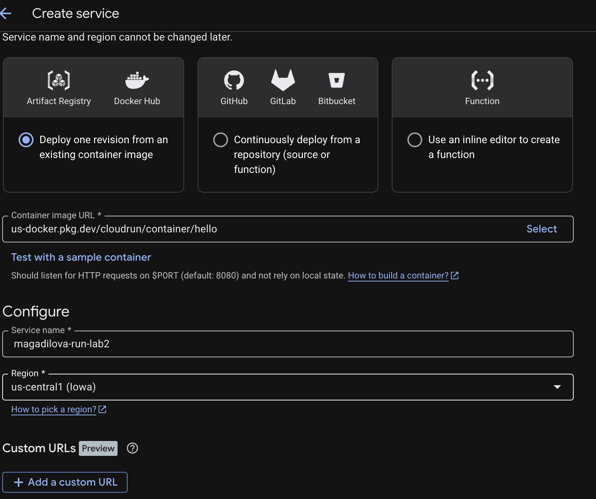

*Рисунок 1 — выбор контейнерного образа, имени сервиса и региона.*

Для обработки запросов установлены лимиты `0.08 vCPU` и `128 MiB`. Минимальное число экземпляров задано равным 0, максимальное — 2, concurrency — 1. Выбрана оплата по запросам. Startup CPU boost оставлен включённым: эта настройка допускает временное увеличение выделяемого CPU при запуске контейнера.

Значения `0.08 vCPU` и `128 MiB` соответствуют минимальным лимитам CPU и памяти для совместимой конфигурации Cloud Run первого поколения. В форме выбора среды оставлен вариант **Default**, то есть автоматический выбор платформой; явный выбор **First generation** на скриншоте не установлен. Для CPU меньше 1 Google требует concurrency 1, оплату по запросам и совместимую среду первого поколения. См. [ограничения CPU](https://docs.cloud.google.com/run/docs/configuring/services/cpu) и [минимальные объёмы памяти](https://docs.cloud.google.com/run/docs/configuring/services/memory-limits).

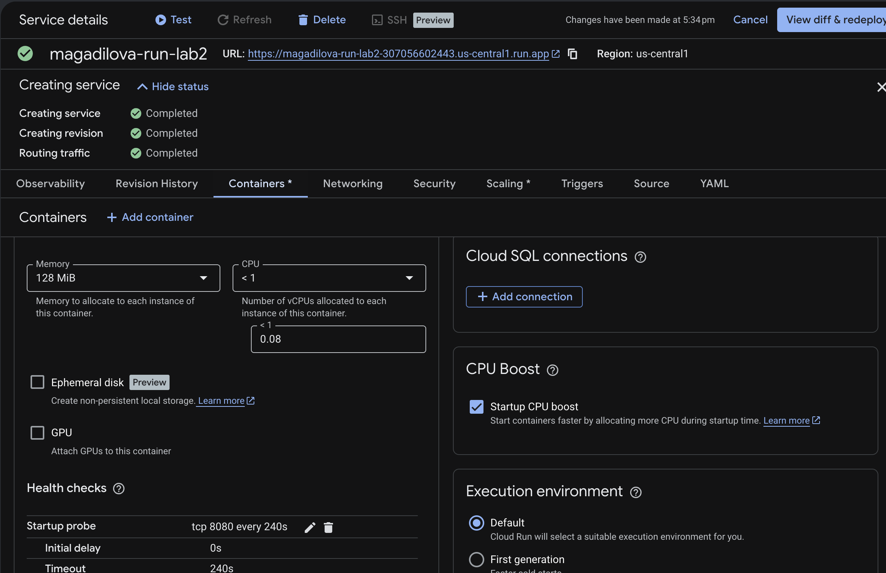

*Рисунок 2 — параметры контейнера: 0.08 vCPU, 128 MiB и Startup CPU boost.*

После развёртывания выполнен переход по HTTPS-адресу сервиса. В браузере открылась стандартная страница Hello с сообщением `It's running!`. На странице указаны проект, регион и ревизия `magadilova-run-lab2-00002-t7m`, которая далее использовалась как ver1.

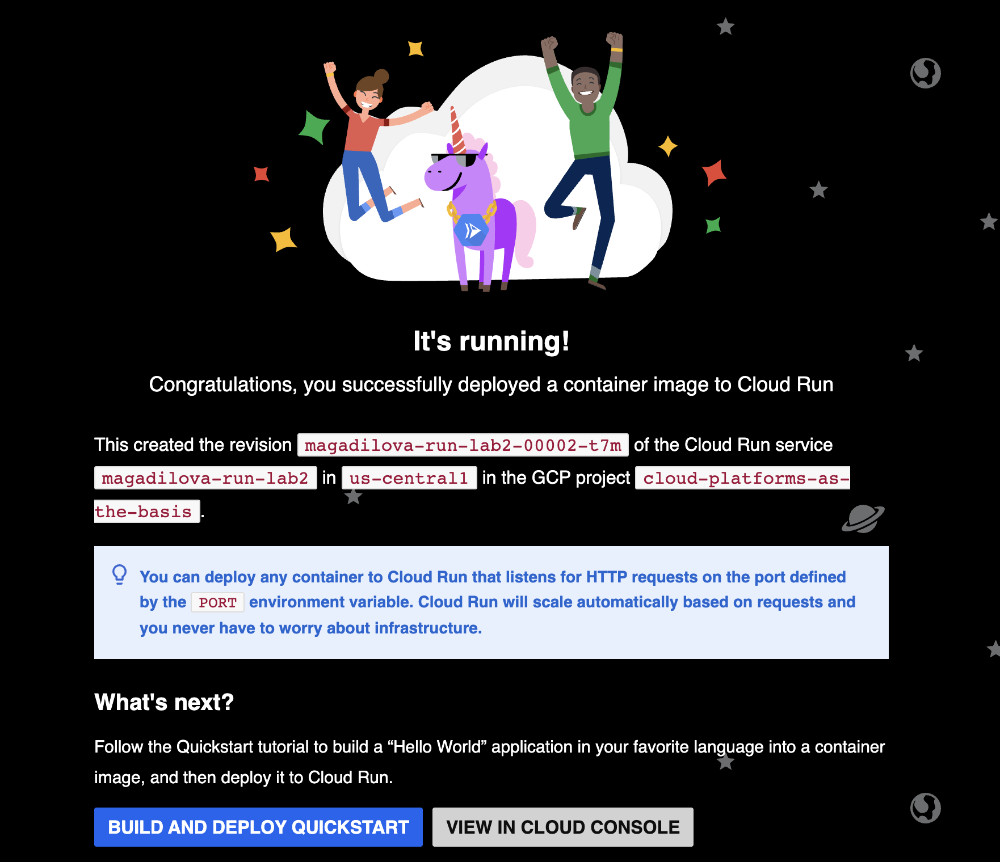

*Рисунок 3 — приложение доступно по HTTPS, запрос обработан ревизией ver1.*

### 2. Проверка доступности и серия запросов

В Cloud Shell адрес сервиса сохранён в переменной:

```bash
LAB2_URL="https://magadilova-run-lab2-307056602443.us-central1.run.app"
```

Для получения HTTP-кода и полного времени выполнения запроса использована команда:

```bash
curl -sS -o /dev/null \
  -w "HTTP %{http_code}; время: %{time_total} с\n" \
  "$LAB2_URL/"
```

Получен результат:

```text
HTTP 200; время: 0.169290 с
```

Затем отправлена серия из 20 последовательных GET-запросов:

```bash
for i in {1..20}; do
  curl -sS -o /dev/null \
    -w "%{http_code}\n" \
    "$LAB2_URL/?stage=initial&n=$i"
done
```

Все 20 запросов первоначальной серии завершились с HTTP `200`. Параметры `stage` и `n` в URL позволяли отличать тестовые обращения в журнале.

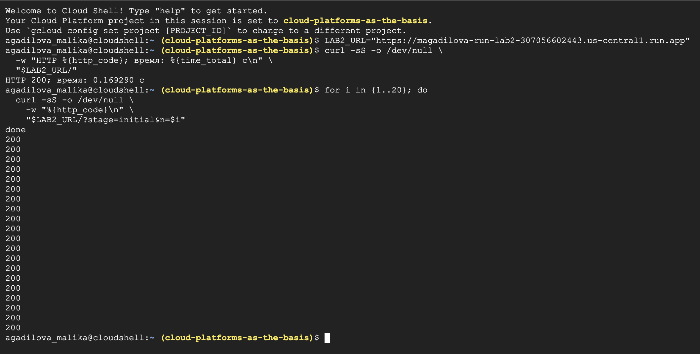

*Рисунок 4 — проверка доступности приложения из Cloud Shell.*

### 3. Анализ журналов и панели ошибок

В разделе журналов сервиса найдены записи первоначальной серии. Для запроса с параметрами `stage=initial&n=2` отображаются метод `GET`, HTTP `200`, размер ответа около 4.96 KiB, клиент `curl 8.5.0` и задержка 26 мс. На соседних показанных строках видны задержки 48 мс и 1 мс.

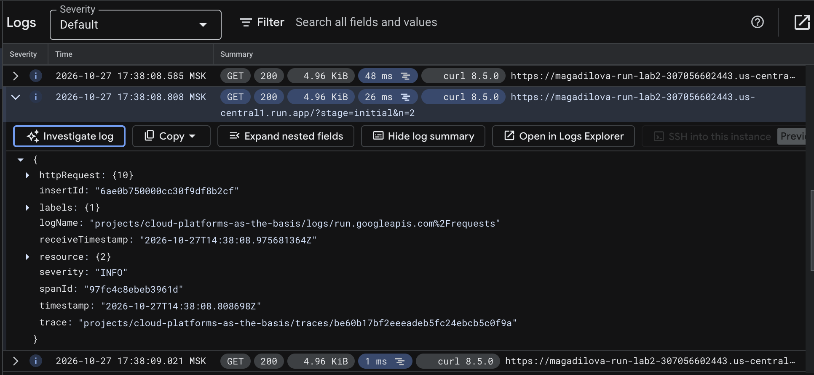

*Рисунок 5 — запросы с кодом 200 и подробности отдельной записи Cloud Logging.*

В панели ошибок на первоначальном этапе отображалось сообщение `No errors found during this interval` для выбранного интервала одного часа.

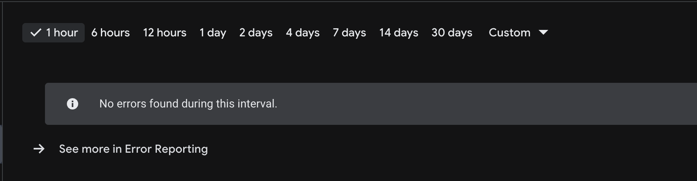

*Рисунок 6 — состояние панели ошибок во время первоначальной проверки.*

Этот экран относится к моменту его получения и не означает отсутствия любых неуспешных HTTP-запросов за всю работу. На последующих этапах в журнале были зафиксированы ответы `429`, рассмотренные ниже.

### 4. Анализ первоначальных метрик

В разделе метрик выбран интервал последних 15 минут. На графике **Request count** виден кратковременный рост частоты ответов класса `2xx` во время тестовой серии. После завершения запросов частота возвращается к нулю.

На графике **Request latencies** представлены процентили 50%, 95% и 99%. Их различие показывает разброс задержек: часть запросов выполнялась дольше основной массы. **End-to-end request latency** отражает задержку полного пути запроса, а **Latency breakdown** позволяет рассматривать её составляющие. На исходном снимке присутствует заметный вклад ожидания (**Pending**) в один из пиков задержки.

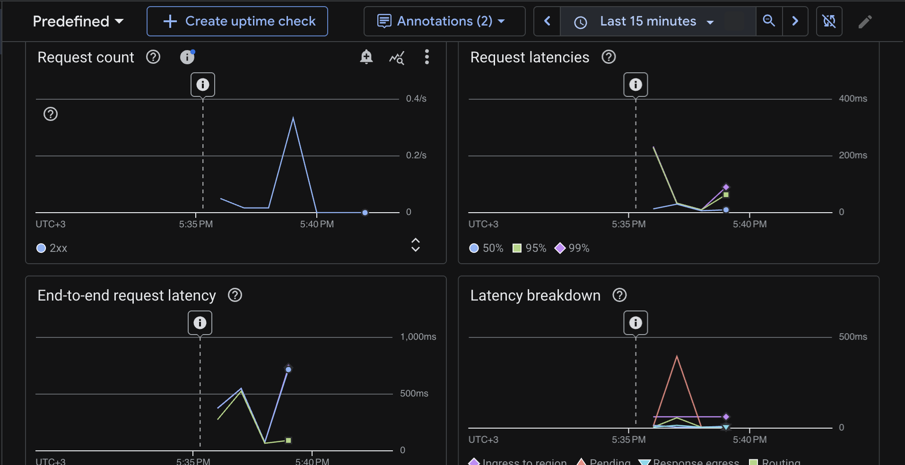

*Рисунок 7 — метрики первоначальной серии: ответы 2xx и изменение задержек.*

Наблюдения сделаны по небольшой серии и агрегированным графикам. Они характеризуют выполненный эксперимент, но не позволяют определить предельную производительность сервиса. Метрики CPU, памяти и числа экземпляров на этом снимке не представлены, поэтому количественные выводы об их загрузке не делались.

### 5. Изменение порта контейнера на 8090

В настройках контейнера поле **Container port** изменено с `8080` на `8090`. Образ Hello сохранён. После применения конфигурации создана рабочая ревизия `magadilova-run-lab2-00003-pwb`, обозначенная как ver2.

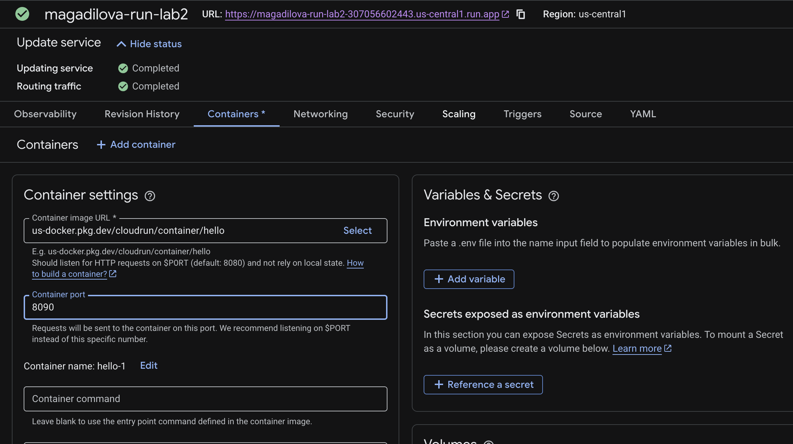

*Рисунок 8 — настройка порта 8090 для новой ревизии.*

По прежнему публичному адресу сервиса выполнен повторный запрос:

```bash
curl -sS -o /dev/null \
  -w "HTTP %{http_code}; время: %{time_total} с\n" \
  "$LAB2_URL/?stage=port8090"
```

Результат:

```text
HTTP 200; время: 0.550590 с
```

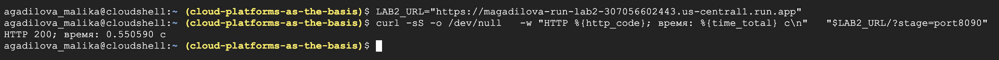

*Рисунок 9 — сервис продолжает отвечать после изменения порта.*

Смена порта не нарушила работу приложения. Cloud Run передаёт настроенный порт через переменную окружения `PORT`; стандартный контейнер Hello рассчитан на её использование. Публичный HTTPS-адрес при этом сохраняется: порт `8090` относится к соединению платформы с контейнером. См. [настройку порта контейнера](https://docs.cloud.google.com/run/docs/configuring/services/containers).

В одиночных замерах получены 0.169290 с до изменения и 0.550590 с после него. По двум запросам нельзя утверждать, что именно смена порта увеличила задержку: на результат также могут влиять запуск экземпляра, ожидание и сетевое взаимодействие.

### 6. Переключение трафика между ver1 и ver2

В истории ревизий проверены три режима распределения трафика:

| Режим | ver1: 00002-t7m, порт 8080 | ver2: 00003-pwb, порт 8090 |
| --- | --- | --- |
| Возврат к ver1 | 100% | 0% |
| Работа ver2 | 0% | 100% |
| Разделение трафика | 50% | 50% |

Ревизиям назначены теги `ver1` и `ver2`. Тестовые запросы направлялись на основной адрес сервиса, чтобы использовать настроенное распределение трафика.

При возврате 100% трафика на ver1 выполнена серия из 40 последовательных запросов:

```bash
for i in {1..40}; do
  curl -sS -o /dev/null \
    -w "%{http_code}\n" \
    "$LAB2_URL/?stage=traffic-test&n=$i"
done
```

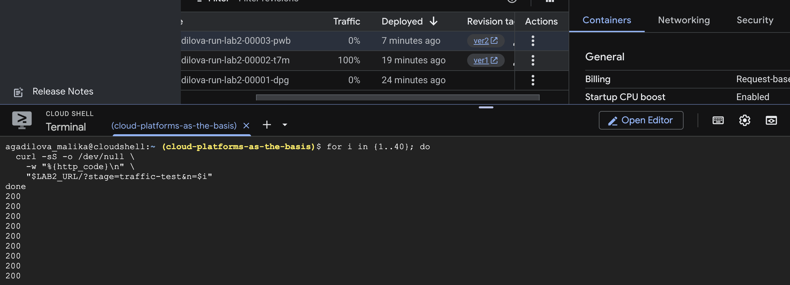

*Рисунок 10 — ver1 получает 100% трафика, ver2 — 0%; на видимой части вывода присутствуют ответы 200.*

В журнале этой проверки наряду с успешными запросами появились HTTP `429`. Позднее зарегистрирован запуск экземпляра по причине `AUTOSCALING` и успешная TCP-проверка запуска контейнера на порту `8080`.

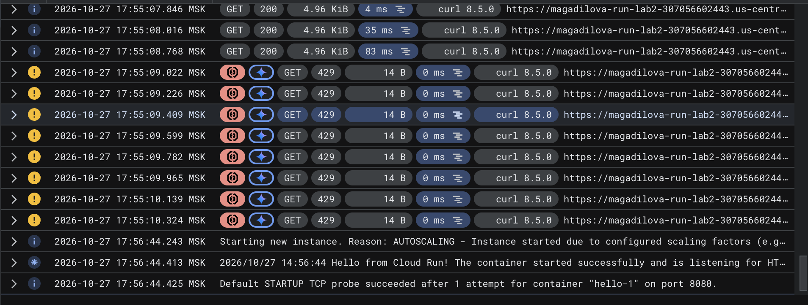

*Рисунок 11 — журнал при проверке ver1: успешные запросы, отказы 429 и последующий запуск экземпляра.*

В режиме 100% на ver2 сервис также был проверен после изменения порта. Успешный ответ с параметром `stage=port8090` приведён на рисунке 9.

После установки распределения 50/50 повторно запущена серия из 40 запросов. В истории ревизий отображаются доли 50% для ver1 и ver2, а первоначальная ревизия `00001-dpg` сохраняет долю 0%. В видимом фрагменте вывода присутствуют как `200`, так и `429`.

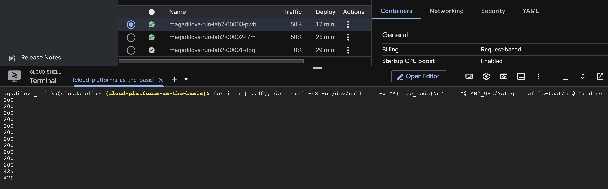

*Рисунок 12 — распределение 50/50 и смешанные результаты тестовых запросов.*

Проценты в настройках задают правила маршрутизации, а не гарантируют точное равенство числа запросов в короткой серии. Полный подсчёт запросов по каждой ревизии в эксперименте не выполнялся; утверждение о фактическом соотношении 20/20 не делается. Возможности переключения и разделения трафика описаны в [документации Cloud Run](https://docs.cloud.google.com/run/docs/rollouts-rollbacks-traffic-migration).

### 7. Анализ HTTP 429 и метрик повторных проверок

HTTP `429` означает отказ в обслуживании части запросов. На показанных строках журнала такие ответы имеют размер 14 B и отображаемую задержку 0 мс. В итоговых метриках появилась отдельная серия класса `4xx` вместе с успешными ответами `2xx`.

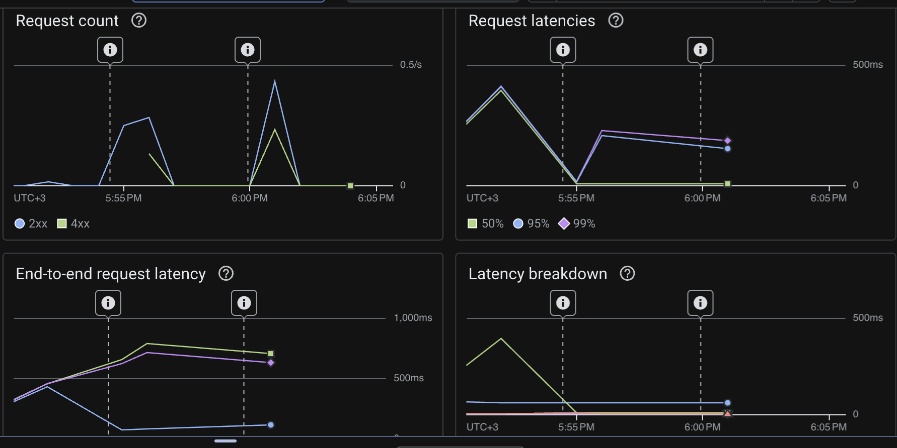

*Рисунок 13 — метрики интервала проверок трафика; график группирует ответы по HTTP-классам, а не по ревизиям.*

На графике количества запросов видны два всплеска, соответствующие интервалам тестовых серий, и наличие `4xx` во время этих проверок. На графиках задержек верхние процентили превышают медиану, то есть небольшая часть обращений имеет более длительное время выполнения.

Возможное объяснение `429` — отсутствие доступного экземпляра при ограниченных возможностях масштабирования и запуске контейнера. Google указывает, что Cloud Run может возвращать `429`, когда сервис достигает ограничения числа экземпляров или не успевает масштабироваться под входящие запросы. См. [раздел No available container instances](https://docs.cloud.google.com/run/docs/troubleshooting#no-available-instance).

В эксперименте заданы минимум 0 и максимум 2 экземпляра при concurrency 1, а в журнале присутствует событие запуска экземпляра. Это согласуется с такой гипотезой, однако не устанавливает точную причину конкретных отказов: подробное сообщение для `429` и график числа экземпляров в материалах проверки не раскрыты. Прямых оснований связывать `429` со сменой порта нет: на `8090` получен успешный `200`, а отказы наблюдались и при возврате трафика на ver1 с портом `8080`.

Для дополнительной диагностики можно сопоставить точное сообщение отказа с числом экземпляров, временем запуска и настройками масштабирования, а затем повторить серию с интервалами между запросами. В рамках данной работы изменение лимитов для устранения `429` не выполнялось.

### 8. Удаление сервиса

После подготовки отчёта и сохранения результатов эксперимента созданный сервис `magadilova-run-lab2` удалён. Очистка ресурсов, созданных для лабораторной работы, выполнена; учебный проект и чужие ресурсы сохранены.

## Результаты

| Проверка | Полученный результат |
| --- | --- |
| Развёртывание Hello | Сервис доступен по HTTPS в регионе us-central1 |
| Настройки ресурсов | 0.08 vCPU, 128 MiB, минимум 0 и максимум 2 экземпляра, concurrency 1 |
| Первоначальный одиночный запрос | HTTP 200; полное время 0.169290 с |
| Первоначальная серия из 20 запросов | Все ответы — HTTP 200 |
| Анализ журналов | Найдены записи GET, коды ответов, задержки и события запуска |
| Первоначальная панель ошибок | Не содержит зарегистрированных событий на момент проверки |
| Смена порта 8080 → 8090 | Новая ревизия работает; одиночный запрос — HTTP 200 за 0.550590 с |
| Переключение трафика | Проверены режимы 100/0, 0/100 и 50/50 между ver1 и ver2 |
| Повторные серии по 40 запросов | В журнале и показанных выводах встречаются HTTP 200 и HTTP 429 |
| Метрики повторных проверок | Присутствуют классы 2xx и 4xx; наблюдается разброс задержек |
| Очистка ресурсов | Сервис magadilova-run-lab2 удалён после подготовки отчёта |

## Выводы

В ходе работы развёрнут контейнерный сервис Hello в Cloud Run с небольшими лимитами CPU и памяти. Проверена доступность приложения по HTTPS, изучены журналы запросов, панель ошибок и метрики. Первоначальная серия из 20 запросов завершилась без HTTP-ошибок.

Изменение внутреннего порта с `8080` на `8090` привело к созданию новой ревизии и не нарушило работу Hello. Это соответствует использованию приложением переменной `PORT`, которую устанавливает Cloud Run. Публичный адрес сервиса сохранился.

Проверены возврат трафика на предыдущую ревизию, направление трафика на новую ревизию и распределение 50/50. При повторных проверках обнаружены отказы HTTP `429`, которые отражены в журнале и метриках класса `4xx`. Они показывают, что успешный запуск приложения и наличие нескольких ревизий сами по себе не гарантируют обслуживание всех запросов при выбранных ограничениях и текущем состоянии экземпляров. Точная причина отказов требует дополнительной диагностики.

Основные эксперименты выполнены. После подготовки отчёта созданный сервис удалён, очистка ресурсов завершена.

## Источники

1. [Задание лабораторной работы №2](https://github.com/ex-itmo-ict-faculty/cloud-platforms-as-the-basis-of-technology-entrepreneurship/blob/main/docs/education/labs2023-2024/lab2/lab2.md).
2. [Правила оформления отчётов](https://github.com/ex-itmo-ict-faculty/cloud-platforms-as-the-basis-of-technology-entrepreneurship/blob/main/docs/education/labs2023-2024/reportdesign.md).
3. [Quickstart: Deploy to Cloud Run](https://docs.cloud.google.com/run/docs/quickstarts/deploy-container).
4. [Configure CPU limits for services](https://docs.cloud.google.com/run/docs/configuring/services/cpu).
5. [Configure memory limits for services](https://docs.cloud.google.com/run/docs/configuring/services/memory-limits).
6. [Configure containers for services](https://docs.cloud.google.com/run/docs/configuring/services/containers).
7. [Logging and viewing logs in Cloud Run](https://docs.cloud.google.com/run/docs/logging).
8. [Monitor Health and Performance](https://docs.cloud.google.com/run/docs/monitoring).
9. [Rollbacks, gradual rollouts, and traffic migration](https://docs.cloud.google.com/run/docs/rollouts-rollbacks-traffic-migration).
10. [Troubleshoot Cloud Run issues](https://docs.cloud.google.com/run/docs/troubleshooting).
