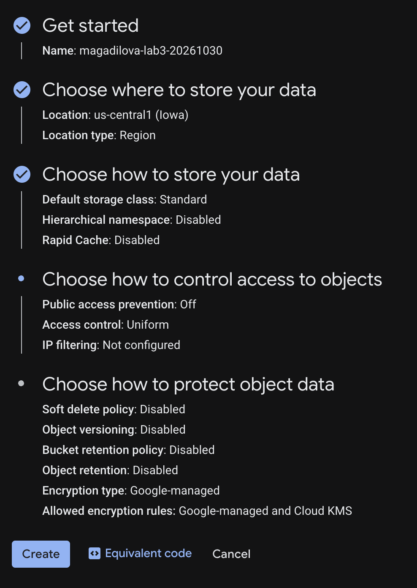
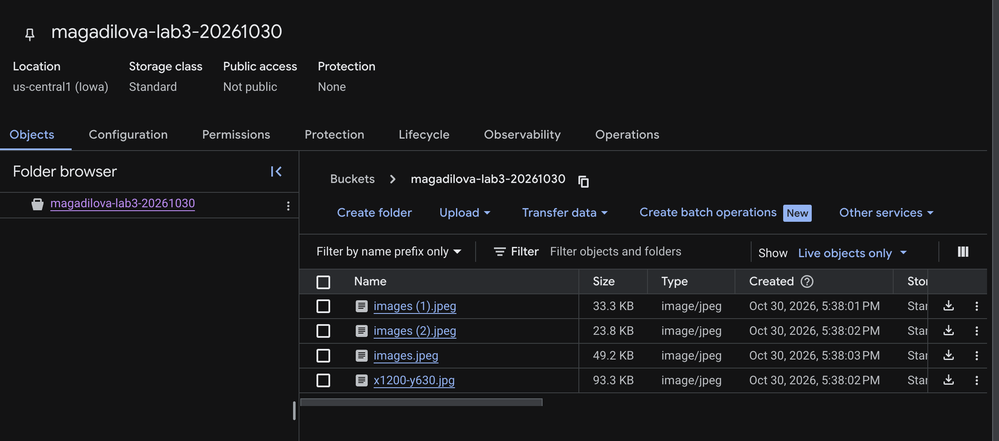
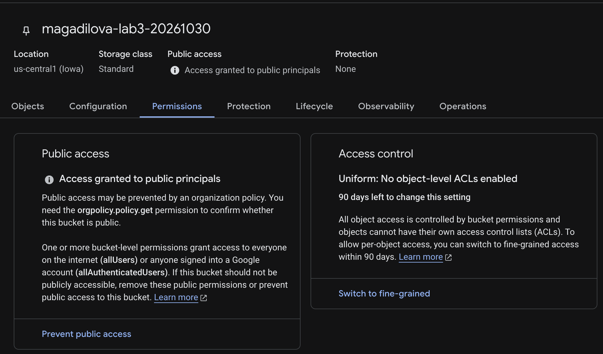
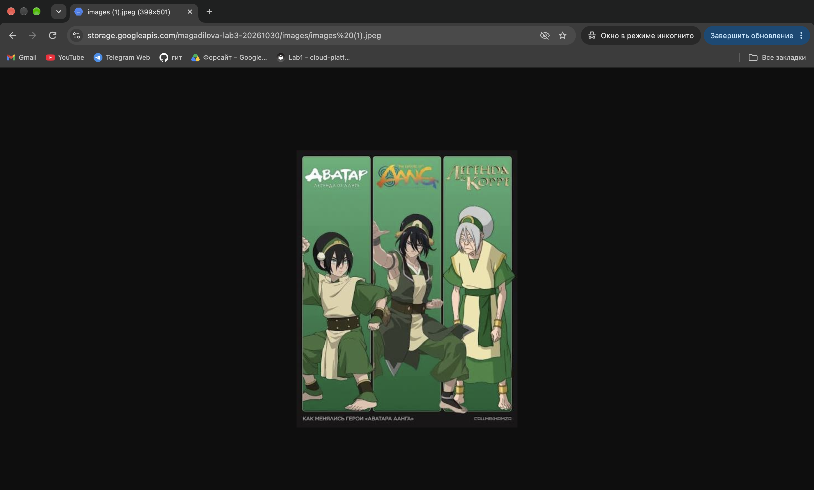

# Лабораторная работа №3. Исследование Cloud Storage

University: [ITMO University](https://itmo.ru/ru/)  
Faculty: [FICT](https://fict.itmo.ru)  
Course: [Cloud platforms as the basis of technology entrepreneurship](https://github.com/ex-itmo-ict-faculty/cloud-platforms-as-the-basis-of-technology-entrepreneurship)  
Year: 2026/2027  
Group: U4225  
Author: Agadilova Malika  
Lab: Lab3  
Date of create: 30.10.2026  
Date of finished: —

Дата окончания заполняется после защиты перед преподавателем.

## Цель работы

Ознакомиться с принципами работы облачного хранилища Google Cloud Storage: создать бакет, загрузить изображения, организовать объекты в папку, настроить публичное чтение и проверить доступ к файлу без входа в Google-аккаунт.

## Задание

1. Выбрать существующий проект с необходимыми разрешениями.
2. Создать бакет Cloud Storage.
3. Загрузить в него 3–4 изображения.
4. Создать папку и переместить в неё файлы в пределах бакета.
5. Настроить публичный доступ к файлам и получить ссылки на них.
6. Проверить результат, удалить созданные ресурсы и подготовить отчёт со скриншотами.

Источник: [задание лабораторной работы №3](https://github.com/ex-itmo-ict-faculty/cloud-platforms-as-the-basis-of-technology-entrepreneurship/blob/main/docs/education/labs2023-2024/lab3/lab3.md).

## Краткие теоретические сведения

Основные модели хранения различаются способом организации данных:

| Модель | Организация данных | Типичное применение |
| --- | --- | --- |
| Блочная | Данные представлены блоками; файловую систему организует использующая диск система | Диски виртуальных машин и хранение данных СУБД |
| Файловая | Файлы доступны через иерархию каталогов | Общие сетевые каталоги и приложения, работающие с файловой системой |
| Объектная | Каждый объект имеет имя, содержимое и метаданные; доступ выполняется через API | Изображения, резервные копии и другие неструктурированные данные |

Cloud Storage относится к объектному хранению. Объекты размещаются в контейнерах — бакетах. Для бакета задаются расположение, класс хранения и правила доступа. В этой работе объектами являлись четыре изображения. См. [обзор Cloud Storage](https://docs.cloud.google.com/storage/docs/introduction).

## Используемые ресурсы и настройки

| Параметр | Значение |
| --- | --- |
| Учебный проект | `cloud-platforms-as-the-basis` |
| Бакет | `magadilova-lab3-20261030` |
| Тип расположения | Region |
| Регион | `us-central1` (Iowa) |
| Класс хранения | Standard |
| Hierarchical namespace | Disabled |
| Rapid Cache | Disabled |
| Public access prevention | Off |
| Управление доступом | Uniform |
| IP filtering | Не настроен |
| Soft delete policy | Disabled |
| Object versioning | Disabled |
| Bucket retention policy / Object retention | Disabled |
| Шифрование | Google-managed |
| Папка для изображений | `images` |
| Публичный участник IAM | `allUsers` |
| Роль публичного участника | Storage Object Viewer (`roles/storage.objectViewer`) |
| Инструменты | Google Cloud Console и Google Chrome |

## Ход работы

### 1. Создание бакета

В учебном проекте открыт раздел **Cloud Storage → Buckets**. Создан собственный бакет `magadilova-lab3-20261030` в регионе `us-central1` с классом хранения Standard.

Для доступа выбрана модель **Uniform**, при которой права на объекты определяются IAM-разрешениями. Запрет публичного доступа **Public access prevention** отключён, чтобы на следующем этапе можно было предоставить публичное чтение. Иерархическое пространство имён и IP-фильтрация не включались.

Soft delete, хранение версий и политики удержания отключены. Для шифрования оставлен вариант Google-managed. Таким образом, для временных учебных данных не настраивалось дополнительное сохранение удалённых объектов и не вводился срок обязательного удержания.



*Рисунок 1 — имя, расположение, класс хранения, управление доступом и настройки защиты данных.*

### 2. Загрузка изображений

В разделе **Objects** загружены четыре изображения. Первоначально они находились в корне бакета:

| Имя файла | Размер в интерфейсе | MIME-тип |
| --- | --- | --- |
| `images (1).jpeg` | 33.3 KB | `image/jpeg` |
| `images (2).jpeg` | 23.8 KB | `image/jpeg` |
| `images.jpeg` | 49.2 KB | `image/jpeg` |
| `x1200-y630.jpg` | 93.3 KB | `image/jpeg` |



*Рисунок 2 — объекты в корне бакета до переноса; публичный доступ ещё не предоставлен.*

На этом этапе в верхней части страницы отображался статус **Not public**. Следовательно, отключение Public access prevention само по себе не сделало данные публичными: оно лишь позволило впоследствии назначить соответствующие разрешения.

### 3. Создание папки и перенос файлов

Внутри бакета создана папка `images`, после чего загруженные файлы перемещены в неё. Объекты получили следующие пути:

```text
gs://magadilova-lab3-20261030/images/images (1).jpeg
gs://magadilova-lab3-20261030/images/images (2).jpeg
gs://magadilova-lab3-20261030/images/images.jpeg
gs://magadilova-lab3-20261030/images/x1200-y630.jpg
```

Поскольку Hierarchical namespace отключён, в данном бакете используется плоское пространство имён. Запись `images/` является префиксом имени объекта, который консоль отображает как папку. Например, полное имя первого объекта после переноса — `images/images (1).jpeg`. Такое представление отличается от каталогов обычной файловой системы. См. [пространство имён объектов Cloud Storage](https://docs.cloud.google.com/storage/docs/objects).

Наличие префикса `images/` в пути проверенного изображения также видно в адресной строке на рисунке 4.

### 4. Настройка публичного доступа

На вкладке **Permissions** для участника `allUsers` назначена роль **Storage Object Viewer** (`roles/storage.objectViewer`) на уровне собственного бакета.

`allUsers` обозначает всех пользователей, включая тех, кто не вошёл в Google-аккаунт. Назначенная роль предоставляет чтение и просмотр списка объектов, но не разрешает их загрузку, изменение или удаление. При модели Uniform эти права применяются через IAM без отдельных ACL объектов. См. [настройку публичного чтения](https://docs.cloud.google.com/storage/docs/access-control/making-data-public).



*Рисунок 3 — после настройки прав отображается Access granted to public principals; отдельные ACL объектов отключены.*

Интерфейс предупреждает, что организационная политика может ограничивать публичность. Поэтому наличие публичных разрешений дополнительно проверялось фактическим открытием изображения в режиме инкогнито.

### 5. Получение ссылок и проверка доступа

Для изображений получены публичные адреса. После переноса они включают имя бакета и префикс `images/`:

| Объект | Публичная ссылка во время эксперимента |
| --- | --- |
| `images/images (1).jpeg` | [images (1).jpeg](https://storage.googleapis.com/magadilova-lab3-20261030/images/images%20%281%29.jpeg) |
| `images/images (2).jpeg` | [images (2).jpeg](https://storage.googleapis.com/magadilova-lab3-20261030/images/images%20%282%29.jpeg) |
| `images/images.jpeg` | [images.jpeg](https://storage.googleapis.com/magadilova-lab3-20261030/images/images.jpeg) |
| `images/x1200-y630.jpg` | [x1200-y630.jpg](https://storage.googleapis.com/magadilova-lab3-20261030/images/x1200-y630.jpg) |

Пробелы и скобки в именах первых двух файлов закодированы в ссылках как `%20`, `%28` и `%29`. Это сохраняет исходное имя объекта и позволяет использовать его в URL.

Первое изображение открыто в отдельном окне Chrome в режиме инкогнито по адресу `storage.googleapis.com`. Браузер отобразил изображение без запроса входа в Google. В адресной строке присутствует путь `magadilova-lab3-20261030/images/images%20(1).jpeg`.



*Рисунок 4 — проверка публичного доступа к images/images (1).jpeg без входа в аккаунт.*

Проверка подтвердила публичную доступность выбранного объекта. Числовой HTTP-код отдельной командой не измерялся: результат зафиксирован отображением изображения в браузере. Приведённые ссылки относятся к моменту эксперимента, до удаления бакета.

### 6. Удаление ресурсов

После сохранения результатов работы изображения и созданный бакет `magadilova-lab3-20261030` удалены. Учебный проект и чужие ресурсы не удалялись.

Soft delete и хранение версий при создании бакета были отключены, поэтому для учебных файлов не настраивалось сохранение удалённых копий для восстановления.

## Результаты

| Проверка | Результат |
| --- | --- |
| Создание собственного бакета | magadilova-lab3-20261030, us-central1, Standard |
| Загрузка изображений | Загружены четыре JPEG-изображения |
| Организация объектов | Файлы перемещены в папку с префиксом images/ |
| Настройка доступа | allUsers с ролью Storage Object Viewer на собственном бакете |
| Состояние доступа в консоли | Изменилось с Not public на Access granted to public principals |
| Проверка публичной ссылки | Изображение открылось в режиме инкогнито без запроса входа |
| Очистка ресурсов | Изображения и собственный бакет удалены |

## Выводы

В ходе работы создан бакет Google Cloud Storage, загружены четыре изображения и выполнен их перенос в папку `images`. Рассмотрены настройки класса хранения, расположения, защиты данных и доступа.

Публичное чтение настроено предоставлением роли Storage Object Viewer участнику `allUsers`. Установлено, что отключение запрета публичного доступа и предоставление публичных разрешений являются разными действиями: до назначения разрешений бакет оставался непубличным. Открытие изображения в режиме инкогнито подтвердило результат настройки.

Работа также показала особенность объектного хранения: при отключённом Hierarchical namespace папка представляется префиксом имени объекта. После завершения эксперимента созданные ресурсы удалены.

## Источники

1. [Задание лабораторной работы №3](https://github.com/ex-itmo-ict-faculty/cloud-platforms-as-the-basis-of-technology-entrepreneurship/blob/main/docs/education/labs2023-2024/lab3/lab3.md).
2. [Правила оформления отчётов](https://github.com/ex-itmo-ict-faculty/cloud-platforms-as-the-basis-of-technology-entrepreneurship/blob/main/docs/education/labs2023-2024/reportdesign.md).
3. [Cloud Storage overview](https://docs.cloud.google.com/storage/docs/introduction).
4. [About Cloud Storage objects](https://docs.cloud.google.com/storage/docs/objects).
5. [Make data public](https://docs.cloud.google.com/storage/docs/access-control/making-data-public).
6. [Soft delete overview](https://docs.cloud.google.com/storage/docs/soft-delete).
